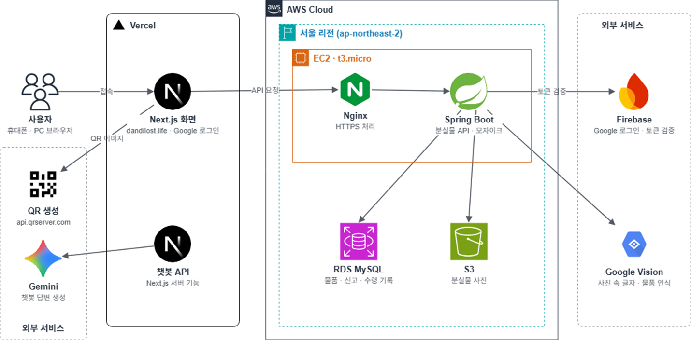
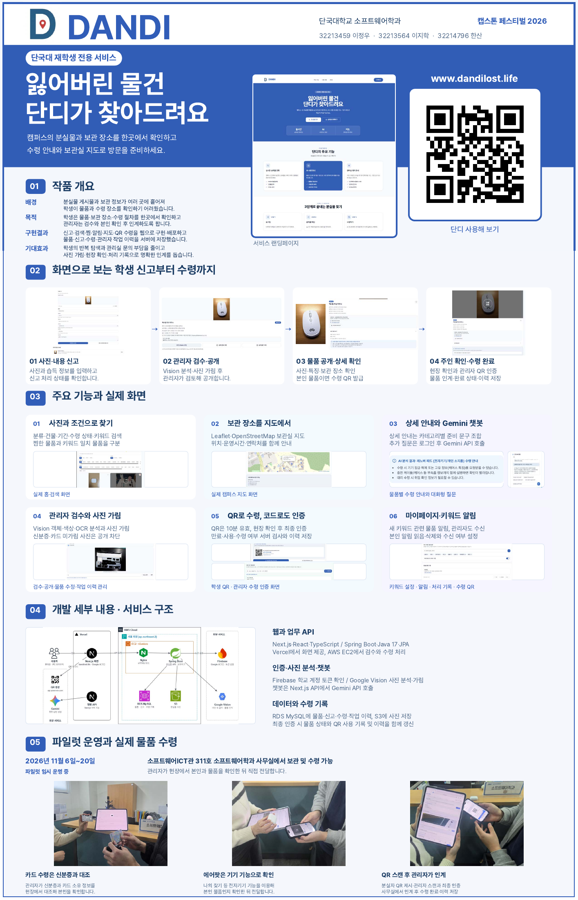

# DANDI Frontend

> 단국대학교 교내 분실물 통합 웹 서비스 **단디**의 프론트엔드. 학생의 신고와 검색부터 관리자 검수, 지도 안내, QR 수령 인증까지 연결하는 Next.js 웹 애플리케이션

[](https://www.dandilost.life)
[](https://www.youtube.com/watch?v=NSqHle27GWg)

| 구분 | 링크 |
|------|------|
| 서비스 | https://www.dandilost.life (임시 운영 2026-11-06 ~ 2026-12-20) |
| 백엔드 | https://github.com/CraneHak/DANDI_lost_and_found_program_management |
| 결과 보고서 | [프로젝트 결과보고서](docs/DANDI_단디팀_프로젝트_결과보고서.pdf) |
| 포스터 | [포스터 PDF](docs/DANDI_단디팀_포스터.pdf) · [이미지](docs/poster.png) |
| 시연 영상 | [DANDI 시연 영상](https://www.youtube.com/watch?v=NSqHle27GWg) |
| 발표 자료 | [발표 자료](docs/DANDI_단디팀_발표자료.pdf) |

팀: 이정우(32213459) · 이지학(32213564) · 한산(32214796) — 단국대학교 소프트웨어학과

소스 코드: [`DANDI/`](DANDI/) · 보관 및 수령 거점: **소프트웨어ICT관 311호 소프트웨어학과 사무실**

---

## 시스템 아키텍처



Vercel의 Next.js 화면에서 Spring Boot API로 신고·물품·수령 정보를 요청합니다. Firebase로 학교 계정에 로그인하며 사진 분석과 가림은 백엔드의 Google Cloud Vision 연동으로 처리합니다. 챗봇은 Next.js 서버 API에서 Gemini API를 호출합니다.

---

## 기술 스택


Next.js App Router를 사용하며 Radix UI, Lucide, Framer Motion으로 화면 구성과 상호작용을 구현했습니다. 관리자 QR 카메라 스캔에는 `jsQR`을 사용합니다.

---

## 핵심 기능

### 1. 학교 계정 로그인과 최초 이용 절차
- Firebase의 학교 Google 계정 로그인 후 ID 토큰을 API 요청에 전달합니다. 백엔드가 토큰과 `@dankook.ac.kr` 이메일을 확인합니다.
- 최초 이용 시 이름·학과·8자리 학번을 입력하고 개인정보 수집·이용에 동의합니다. 기존 로그인 세션이 있으면 로그인 화면을 반복하지 않고 서비스를 이용합니다.
- 일반 사용자와 관리자 화면을 구분하며 서버가 역할과 본인 데이터의 접근 범위를 확인합니다.

### 2. 신고와 관리자 검수·공개
- 학생이 사진·물품 이름·습득 장소·시각을 입력하면 검수 대기 신고로 접수됩니다. 관리자가 보관 장소와 공개 정보를 보완한 뒤 물품 목록에 공개합니다.
- 기존 신고 사진을 다시 선택하지 않고 Vision 분석을 요청할 수 있습니다. 객체·색상·OCR 결과와 가림 사진을 확인해 등록 정보를 보완합니다.
- 신분증·카드의 모자이크 미적용 사진은 공개를 차단하고 안내 팝업을 표시합니다. 관리자는 공개 물품의 수정·삭제와 처리 이력을 확인합니다.

### 3. 물품 검색과 관심 페이지
- 카테고리·건물·기간·수령 상태·키워드를 함께 적용해 물품을 찾습니다. 목록과 상세 화면은 공개 물품 ID를 기준으로 연결합니다.
- 관심 페이지에서 **직접 찜한 물품**과 **등록한 문자열에 일치하는 물품**을 구분하며 키워드별로 목록을 좁힙니다. 키워드 일치는 문자열 비교 방식입니다.
- 찜은 사용자별 서버 API 저장을 기본으로 합니다. 계정별 로컬 캐시와 기존 데이터 이전을 지원하고 서버 미지원 시에는 기기 저장으로 대응합니다.

### 4. 상세 정보·보관실 지도·Gemini 챗봇
- 사진·습득 정보·보관 장소·수령 안내를 확인하고 Leaflet·OpenStreetMap 지도에서 보관실 위치·운영시간·연락처를 확인합니다.
- `/api/ai-guidance`의 상세 수령 안내는 카테고리에 맞춘 준비 문구를 조합합니다. 이 경로에서는 LLM을 호출하지 않습니다.
- 대화형 챗봇 `/api/chatbot`은 로그인 토큰을 확인한 후 Gemini의 OpenAI 호환 API에 질문과 최근 대화를 전달합니다. 질문 500자, 이전 대화 최대 8개, 사용자당 분당 10회 제한이며 호출 횟수는 인스턴스 메모리에서 관리합니다. 모델은 배포 환경 설정에 따릅니다.

### 5. QR 수령 인증과 완료 표시
- 본인 물품을 확인한 사용자가 **10분 유효 수령 QR**을 발급받고 거점을 방문합니다. QR 이미지는 `api.qrserver.com`을 이용합니다.
- 현장에서 신분증이나 물품 특징을 대조합니다. 카드는 신분증과 소유 정보를 확인하고 에어팟은 나의 찾기 등 기기 기능을 활용해 확인합니다.
- 분실자가 QR을 제시하면 관리자가 카메라로 스캔하거나 코드를 입력해 최종 인증합니다. 만료·사용 여부와 물품 상태 검사 및 수령 상태 갱신은 백엔드에서 처리합니다.
- 발급만으로 수령이 완료되지는 않습니다. 최종 인증 후 회색 배경·흑백 사진·완료 문구를 표시하고 관리자 화면에 처리 이력을 남깁니다.

### 6. 알림과 사용자 설정
- 신고 처리 결과와 관심 키워드 일치 소식을 **서비스 내부 알림**으로 제공합니다. 서버 DB에 저장된 본인 수신 목록, 미확인 개수, 읽음 처리와 개별·전체 삭제를 지원합니다.
- 마이페이지에서 관심 키워드를 등록·삭제하고 알림 수신 여부를 설정합니다. 새 키워드를 등록하면 관련 물품 알림을 받고 관리자 계정도 키워드 알림을 수신할 수 있습니다.

---

## 트러블슈팅

화면 표시와 서버 상태를 맞추기 위해 수정한 주요 사례입니다.

### 1. 신고 ID와 물품 ID 혼용으로 상세 조회와 삭제 대상이 어긋남
- **문제**: 신고와 공개 물품의 번호를 같은 식별자로 처리해 다른 상세 화면을 열거나 수정·삭제 후 잘못된 항목을 갱신할 수 있었습니다.
- **해결**: 신고 ID와 공개 물품 ID를 구분하고 목록·상세·관심 저장에서 사용할 서버 물품 ID와 연결 관계를 정리했습니다. (`e88e720`, `dff14e4`)
- **결과**: 같은 번호를 가진 신고와 물품도 각자의 경로로 처리하며 상세 조회와 화면 갱신의 대상을 일치시켰습니다.

### 2. 검수 수정 사항이 저장되지 않거나 화면에 이전 상태가 남음
- **문제**: 보관 장소·메모·사진을 수정해도 검수 카드와 홈 목록에 이전 정보가 남거나 검수 직후 중복 항목이 보였습니다.
- **해결**: 서버 응답을 기준으로 카드를 갱신하고 신고·공개 물품 연결 및 사진 유지 처리를 보완했습니다. (`a586e93`, `c48956e`)
- **결과**: 검수 저장과 공개 이후 목록·상세 화면이 같은 물품 정보를 참조하도록 정리했습니다.

### 3. 수령 인증 후 물품이 삭제되어 완료 기록을 다시 볼 수 없음
- **문제**: 인증 후 삭제 요청을 보내는 흐름 때문에 수령이 끝난 물품을 목록과 처리 화면에서 계속 확인하기 어려웠습니다.
- **해결**: 인증 뒤 별도 삭제 요청을 제거하고 서버의 수령 완료 상태를 유지해 화면에 반영했습니다. (`afd610b`)
- **결과**: 완료된 물품과 수령 가능한 물품을 구분하며 수령 결과와 처리 기록을 다시 확인할 수 있습니다.

### 4. 기기를 바꾸면 관리자 이력과 알림 설정이 달라짐
- **문제**: 브라우저 저장값에 의존한 이력·수령 코드·알림 설정이 다른 기기에서 일치하지 않았습니다.
- **해결**: 관리자 작업 이력과 수령 코드 및 알림 수신 설정을 서버 기준으로 표시하고 알림 목록은 DB 데이터로 통일했습니다. (`b506c84`, `149c033`)
- **결과**: 로그인한 계정에 연결된 서버 정보를 바탕으로 이력과 설정을 표시합니다.

---

## 로컬 사용법

```bash
git clone https://github.com/hprays/DANDI-lost-and-found-program.git
cd DANDI-lost-and-found-program/DANDI
cp .env.example .env.local
npm ci
npm run dev
```

브라우저에서 http://localhost:3000 으로 접속합니다. Spring Boot 백엔드는 별도로 실행하고 `.env.local`의 `NEXT_PUBLIC_API_BASE_URL`을 지정합니다. 기본 API 주소는 `http://localhost:8080`입니다.

| 환경 변수 | 용도 |
|-----------|------|
| `NEXT_PUBLIC_API_BASE_URL` | Spring Boot API 주소 |
| `NEXT_PUBLIC_FIREBASE_*` | Firebase 웹 앱 설정 |
| `NEXT_PUBLIC_ADMIN_EMAILS` | 관리자 화면 접근에 사용하는 이메일 목록. 최종 API 권한은 서버가 확인 |
| `LLM_API_KEY` | 챗봇의 서버 API 키 |
| `LLM_BASE_URL` | Gemini 등 LLM 호환 API 기본 주소 |
| `LLM_MODEL` | 사용할 배포 모델 이름 |

Gemini 연결 예시는 `.env.example`의 `LLM_BASE_URL=https://generativelanguage.googleapis.com/v1beta/openai`를 참고하세요. 챗봇 API 키에 `NEXT_PUBLIC_` 접두사를 붙이지 않습니다. `LLM_MODEL`은 사용할 모델에 맞게 설정합니다. `.env.local`은 Git에 올리지 않습니다.

점검과 프로덕션 빌드:

```bash
npm run check:ids
npm run check:filters
npm run lint
npm run build
npm start
```

---

## 프로젝트 자료

<a href="docs/DANDI_단디팀_포스터.pdf"></a>

[결과보고서](docs/DANDI_단디팀_프로젝트_결과보고서.pdf) · [발표자료](docs/DANDI_단디팀_발표자료.pdf) · [포스터 PDF](docs/DANDI_단디팀_포스터.pdf) · [시연 영상](https://www.youtube.com/watch?v=NSqHle27GWg)
